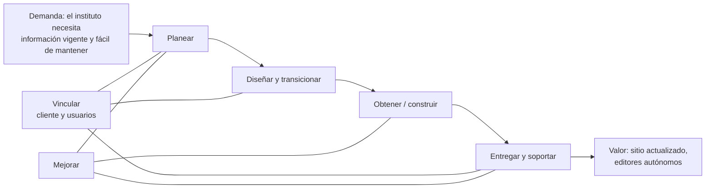

# ITIL 4 aplicado al proyecto del IFTS N.° 2

> Materia: **Práctica Profesionalizante IV (Proyecto Integrador)**. Corresponde a la última sección del aula virtual ("ITIL 4 Foundation: generando valor a nuestra aplicación"), cuyos productos esperados son informes breves, casos prácticos, mapas conceptuales, reflexiones grupales y una presentación. Este documento es un **borrador** para que el equipo lo revise y lo adapte. Fuente teórica: `material/ITIL-4-Foundation-Material-Participante.pdf`. La actividad no tiene fecha confirmada ni consigna formal propia; se trabaja con la orientación del aula.

## 1. Qué es ITIL y por qué importa en este proyecto

ITIL (Information Technology Infrastructure Library) es un conjunto de buenas prácticas para gestionar **servicios de tecnología** (ITSM). Su idea central es que un sistema no es solo código: es un **servicio** que tiene que generar valor para quien lo usa, y que hay que operar, soportar y mejorar de forma continua.

Para Talento Tech, el sitio y el panel del IFTS N.° 2 son un servicio que se entrega a una institución pública. Aunque el equipo desarrolla el producto, el instituto lo va a **usar todos los días con personal no técnico**, y el sitio actual se abandonó justamente por no tener una forma simple de mantenerlo.

| Concepto ITIL | En este proyecto |
|---|---|
| Proveedor del servicio | Talento Tech (y, a futuro, la cohorte que lo mantenga) |
| Cliente (quien define requisitos y decide) | IFTS N.° 2: Rectoría, asesor pedagógico |
| Usuarios | Aspirantes, alumnos, egresados (sitio) y editores, bedelía y administradores (panel) |
| Servicio | Plataforma web institucional: sitio público y panel de gestión |
| Valor | Información vigente y confiable, menos trabajo manual, imagen institucional acorde a "formar emprendedores" |
| Utilidad (para qué sirve) | Publicar y consultar novedades, avisos, horarios, mesas y archivo |
| Garantía (cómo se comporta) | Disponible en picos de 300 a 400 usuarios, seguro, accesible, rápido en el celular |

## 2. Las cuatro dimensiones aplicadas

| Dimensión | Qué mira | En el proyecto |
|---|---|---|
| Organizaciones y personas | Roles, estructura, cultura, competencias | Tres roles del panel (Administrador, Bedelía, Editor); capacitación a docentes no técnicos; un único canal con el cliente (Martín Juan) |
| Información y tecnología | Datos, conocimiento, herramientas | Modelo de datos con auditoría; stack Next.js, Node y PostgreSQL; manual de usuario y documentación técnica |
| Socios y proveedores | Dependencias externas | Instagram (API), hosting y base gratuitos, servicio de correo y almacenamiento; plan de contingencia si fallan |
| Flujos de valor y procesos | Cómo se transforma una necesidad en servicio | Flujo de moderación de publicaciones, vigencia y archivo de avisos, carga de horarios y mesas |

## 3. Cadena de valor del servicio

El material de ITIL 4 define **seis** actividades (el aula menciona cinco; la sexta es *Vincular*). Así se ven en el proyecto:

| Actividad | Qué es | En el proyecto |
|---|---|---|
| Planear | Visión, estrategia y planificación compartidas | Relevamiento, objetivos SMART, cronograma, riesgos |
| Vincular | Entender y atender a las partes interesadas | Reuniones con el cliente (04/09 y 06/10), canal único, devoluciones sobre el diseño |
| Diseñar y transicionar | Diseñar el servicio y pasarlo a operación | Figma, diagramas, especificaciones, capacitación a editores |
| Obtener / construir | Conseguir o construir los componentes | Desarrollo del API, sitio y panel; integración con Instagram |
| Entregar y soportar | Operar y dar soporte | Despliegue, respaldos, formulario de contacto, mantenimiento |
| Mejorar | Mejora continua en todo el recorrido | Retrospectiva por sprint, ajuste de paleta y menú tras el feedback |

## 4. Las siete prácticas del material, aplicadas

| Práctica | Cómo se aplica a la plataforma |
|---|---|
| **Mejora continua** | Retrospectiva al cierre de cada sprint; indicadores de la sección 6 de Gestión de Proyectos; se registran las mejoras propuestas por el cliente (menú, paleta, calendario) |
| **Control de cambios** | Todo cambio de alcance pasa por el Product Owner y queda en `proyecto/decisiones.md`; los cambios de contenido en la plataforma quedan en el registro de auditoría |
| **Gestión de incidentes** | Restaurar el servicio rápido cuando algo falla (ver caso de abajo) |
| **Gestión de problemas** | Encontrar y corregir la causa de fondo de incidentes repetidos |
| **Gestión de solicitudes de servicio** | Pedidos habituales y previsibles: alta de un usuario, cambio de rol, carga de un aviso, restablecer una contraseña |
| **Mesa de servicio** | Punto único de contacto: Martín Juan hacia el cliente y, para el público, el formulario de contacto con bandeja en el panel |
| **Gestión de niveles de servicio** | Compromisos medibles con el cliente: disponibilidad, tiempos de respuesta y de resolución (sección 7) |

## 5. Caso práctico: gestión de incidentes y problemas

**Escenario.** Un lunes de inscripción a la tecnicatura la sincronización con Instagram deja de traer publicaciones y, además, el sitio responde lento a media mañana.

**Registro del incidente.**

| Campo | Incidente A | Incidente B |
|---|---|---|
| Descripción | La sincronización con Instagram devuelve error | El sitio público tarda más de 5 segundos en cargar |
| Quién lo detecta | El editor, en el Resumen del panel | Un alumno, por el formulario de contacto |
| Impacto | Medio: no se actualizan novedades, pero el sitio funciona | Alto: afecta a muchos usuarios en un pico |
| Urgencia | Media | Alta |
| Prioridad | Media | **Alta** |
| Respuesta inmediata | Cargar la publicación a mano desde el panel (contingencia prevista) | Servir páginas desde caché y revisar el estado del proveedor |
| Escalamiento | A Nicolás Rolón (backend), que revisa el token | A Santiago Cuda (DevOps) |
| Resolución | Renovar el token de acceso | Ajustar el plan de hosting o la caché |
| Comunicación | Aviso al editor desde el panel | Aviso al instituto por el canal único |

**Priorización.** Se prioriza combinando impacto y urgencia: lo que afecta a muchos usuarios y no admite espera va primero.

**Problema.** Si el token de Instagram vence más de una vez, deja de ser un incidente suelto: se abre un **problema** para eliminar la causa (renovación automática antes de los 60 días y alerta en el Resumen). Lo mismo si un proveedor gratuito suspende el servicio por inactividad.

## 6. Relación con metodologías ágiles y DevOps

ITIL organiza el servicio y las metodologías ágiles organizan la construcción: Scrumban entrega incrementos al cliente (vincular, obtener y construir), mientras que ITIL asegura que cada entrega pase a operación con soporte y mejora. DevOps conecta ambos con integración y entrega continuas (GitHub Actions), pruebas automáticas y respaldos, que reducen incidentes antes de que lleguen al usuario.

## 7. Niveles de servicio propuestos

| Aspecto | Compromiso propuesto | Cómo se mide |
|---|---|---|
| Disponibilidad del sitio público | Alta, con degradación controlada si fallan integraciones | Monitoreo del endpoint de salud |
| Capacidad | 300 a 400 usuarios concurrentes en picos | Prueba de carga |
| Respuesta a incidentes de prioridad alta | `[completar con el cliente]` | Tiempo entre el aviso y la primera respuesta |
| Respuesta a solicitudes habituales | `[completar con el cliente]` | Bandeja de contacto y registro de solicitudes |

Los tiempos concretos no están acordados con el instituto; deben definirse con él antes de comprometerse.

## 8. Reflexión sobre la experiencia del usuario

El proyecto nació de un problema de experiencia, no de tecnología: un sitio que "parece de colegio secundario" y que nadie podía mantener. Las decisiones de mayor valor fueron las que redujeron el esfuerzo de las personas: un panel con pocas pantallas y confirmaciones claras, vigencia automática en lugar de tareas manuales, y alternativas manuales cuando una integración falla. Cada devolución del cliente (la paleta, el menú que separa ingreso e inscripciones, el calendario por archivos) fue un ciclo de mejora continua que ajustó el servicio a su uso real. `[El equipo completa aquí sus conclusiones y ejemplos propios.]`

## 9. Qué falta para presentarlo

- Revisar y completar las secciones marcadas `[completar]`.
- Pasar el contenido a la herramienta que prefiera el equipo (documento y presentación) y exportar el mapa conceptual.
- Confirmar con los docentes la fecha y el formato de los productos de ITIL.
