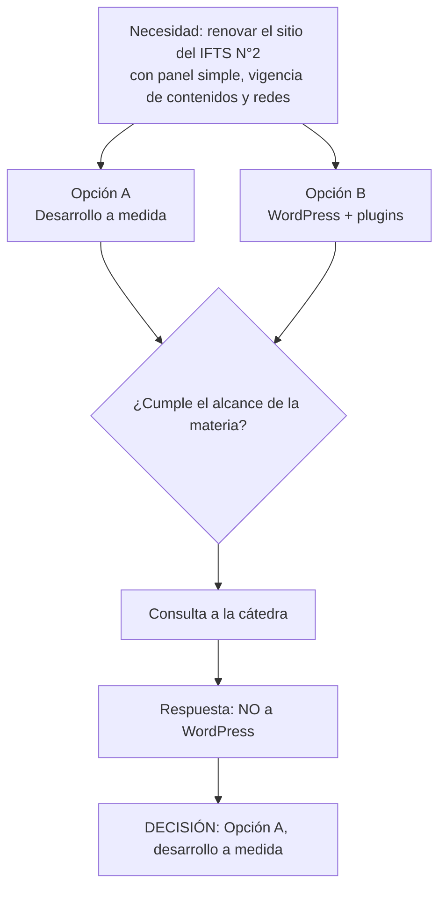

# Registro de decisiones del proyecto

> Bitácora de decisiones (la cátedra la pide como entregable: "registro de decisiones tomadas"). Cada entrada: qué se decidió, quién, por qué y qué descarta. Agregar las nuevas arriba. Los datos que no constan en el repo van como `[completar]`.

---

## D-001 · Desarrollo a medida; WordPress descartado por la cátedra

- **Estado:** cerrada.
- **Fecha:** `[completar]`
- **Decide:** la cátedra (docentes de Desarrollo de Software, IFTS N°29), a consulta del equipo.
- **Contexto:** en la Etapa 1 el equipo planteó dos alternativas: (A) desarrollo a medida de sitio, panel y API; (B) WordPress con plugins como plan B, "pendiente de validar con la cátedra". WordPress ofrecía menos tiempo de implementación y menor costo de mantenimiento, pero menor cobertura de los objetivos de la materia.
- **Decisión:** se va por la **opción A, desarrollo a medida**. **No se usa WordPress ni otro CMS de terceros.**
- **Motivo:** el alcance de la materia (Prácticas Profesionalizantes IV) exige recorrer un ciclo completo de ingeniería de software: diseño, backend, base de datos, seguridad, testing y despliegue propios.
- **Consecuencias:**
  - El stack se define y justifica en la Etapa 2 (Next.js, Node.js/Express, PostgreSQL), sujeto a validación técnica de DevOps.
  - Se asume mayor tiempo de desarrollo y de pruebas; se mitiga con el MVP priorizado en el Figma y con infraestructura gratuita.
  - El riesgo "definición tecnológica custom vs. WordPress sin validar" (Etapa 1) queda **resuelto**.
  - WordPress solo se menciona como referencia de mercado en el análisis de competencia.

Versión gráfica: [diagramas/decision-001-desarrollo-a-medida.png](diagramas/decision-001-desarrollo-a-medida.png) (fuente `.mmd` y `.svg` en la misma carpeta).

---

## D-008 · Valor hora y licencia (en PPIV Etapa 2)

- **Estado:** vigente · **Fecha:** `[completar]` · **Decide:** equipo Talento Tech.
- **Decisión:** valor hora referencial **USD 30**; 680 h × USD 30 = **USD 20.400** aproximados (proyecto académico sin cobro, solo para dimensionar). Licencia propuesta: **MIT** con cesión de uso al IFTS N°2; contenidos y marca son del instituto. Formalizar en GdP Parte 2 (sostenibilidad y presupuesto).

## D-009 · Requerimientos no funcionales ampliados

- **Estado:** vigente · **Decide:** equipo, en Etapa 2.
- **Decisión:** a los RNF01–06 de la Etapa 1 se suman **RNF07** (accesibilidad WCAG 2.2 nivel AA en páginas públicas) y **RNF08** (protección de datos personales, Ley 25.326, en formulario de contacto e imágenes de estudiantes, con consentimiento). RNF03 se amplía: el sitio sigue funcionando si fallan Instagram o el correo, con respaldos periódicos. **Pendiente:** clasificar cada requerimiento por origen (Negocio / Sistemas) para la GdP Parte 2.

## D-002 · Canal único con el cliente: Martín Juan (Product Owner)

- **Estado:** cerrada · **Fecha:** `[completar]` · **Decide:** equipo Talento Tech.
- **Decisión:** Martín Juan es el único interlocutor con el IFTS N°2, para no saturar al cliente ni dar respuestas contradictorias con tres grupos en paralelo. Fuente: Etapa 1 y Gestión de Proyectos Parte 1.
- **Aclaración:** Javier Navarro ("Javier N.") pertenece a otro grupo de desarrollo y no es contacto nuestro ni del cliente.

## D-003 · Metodología Scrumban con Trello (argumentación corregida)

- **Estado:** cerrada, **justificación a reformular** · **Fecha:** `[completar]` · **Decide:** equipo Talento Tech.
- **Decisión:** sprints livianos alineados a los hitos de semana 2, 6 y 13 más tablero Kanban continuo; Trello como herramienta.
- **Corrección de la cátedra (GdP Parte 1, 04/10 aprox.):** "Scrum está pensado para equipos más grandes y full-time" **no es un criterio válido** para descartarlo. Scrumban debe justificarse por **necesidades de flujo, iteración y control** del proyecto. La Etapa 2 (PDF entregado, 3.3) ya usa ese enfoque; la Parte 2 de GdP debe hacer lo mismo.
- **Argumentos a usar:** hitos fijos con el cliente (iteración y puntos de control), trabajo continuo con prioridades que cambian por la disponibilidad del cliente (flujo), límite de trabajo en curso y revisión cruzada (control).

## D-004 · Nunca se borra contenido: se archiva

- **Estado:** cerrada · **Fecha:** 04/09/2026 · **Decide:** cliente (IFTS N°2), en la reunión de relevamiento.
- **Decisión:** el contenido vencido se oculta o archiva, jamás se elimina de forma automática ni irreversible ("un riesgo grave"). Lo anterior al período vigente se puede borrar solo manualmente.

## D-005 · Redes sociales: selección editorial, de las redes hacia el sitio

- **Estado:** cerrada · **Fecha:** 04/09/2026 · **Decide:** cliente, validado en la reunión.
- **Decisión:** no se replica todo Instagram/Facebook: se etiqueta con un hashtag y el instituto selecciona qué se muestra y por cuánto tiempo. El flujo es redes → sitio; la publicación desde el sitio hacia redes queda fuera de alcance.
- **Pendiente técnico:** validar la integración con la API de Instagram (el Figma lo declara "sujeto a validación técnica"); plan de contingencia: carga manual asistida.

## D-006 · Infraestructura gratuita en la etapa inicial

- **Estado:** cerrada · **Fecha:** 04/09/2026 · **Decide:** cliente (restricción presupuestaria).
- **Decisión:** se priorizan hosting, base de datos y dominio gratuitos; un dominio pago (.com.ar, unos $8.500 ARS/año) o uno .edu.ar se evalúa después con el instituto.

## D-007 · Identidad visual del prototipo: paleta tierra definida a partir del feedback del cliente

- **Estado:** vigente · **Fecha:** reunión con el cliente reciente (`[completar]`); Figma actualizado 18/10/2026 · **Decide:** equipo, tras el rechazo del cliente a la paleta verde.
- **Historia:** primero se usó azul `#24507F` (Talento Tech, descartado por no ser del cliente); luego verde `#123B30 / #087B48 / #E4BA6E` tomado del logo (es la que está en la Etapa 2 entregada); el cliente no la aprobó.
- **Decisión vigente:** paleta tierra con tokens primary `#8D775F`, base `#F6F6F3`, accent `#6F5142`, accent-2 `#E0DFD5`, accent-3 `#291711`, font `#6E7271`, más semánticos de éxito, advertencia y peligro; Inter; fotografías reales. Detalle en `proyecto/context.md` §5.
- **Pendiente:** el cliente dará correcciones adicionales.

## D-011 · Decisiones técnicas del MVP (Etapa 3)

- **Estado:** propuesta, detalle y estados en `materias/ppiv-proyecto-integrador/entrega-3/especificaciones/02-decisiones-tecnicas.md` · **Fecha:** 18/10/2026.
- **Resumen:** monorepo pnpm; Next.js + Express + PostgreSQL/Prisma (Etapa 2); sesiones en base con argon2id; vigencia calculada al consultar y sin borrado físico; archivos y Instagram detrás de interfaces; tres roles (ADMIN, BEDELIA, EDITOR) a validar con el cliente; hosting gratuito a validar por DevOps.

## D-010 · No se reentrega la Etapa 2; foco en Etapa 3 (specs para un agente)

- **Estado:** cerrada · **Fecha:** 18/10/2026 · **Decide:** equipo.
- **Decisión:** el PDF de Etapa 2 queda como entregado. Para la Etapa 3 (MVP) no se programa en este repo: se arma `materias/ppiv-proyecto-integrador/entrega-3/` con especificaciones y decisiones técnicas para que un agente en otro repositorio y otra sesión genere el proyecto.
